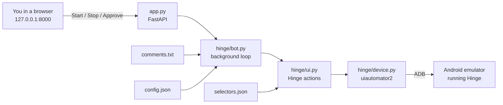
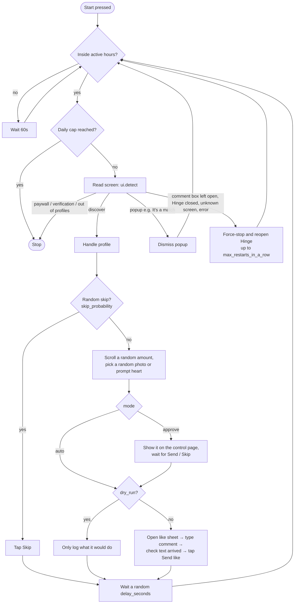
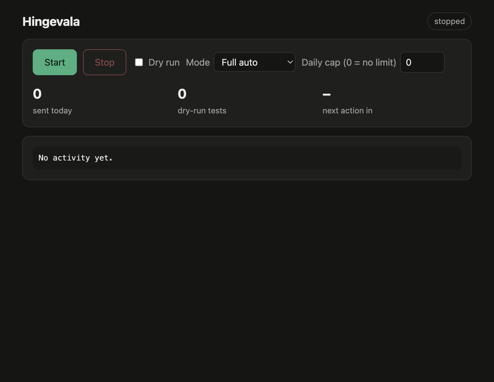
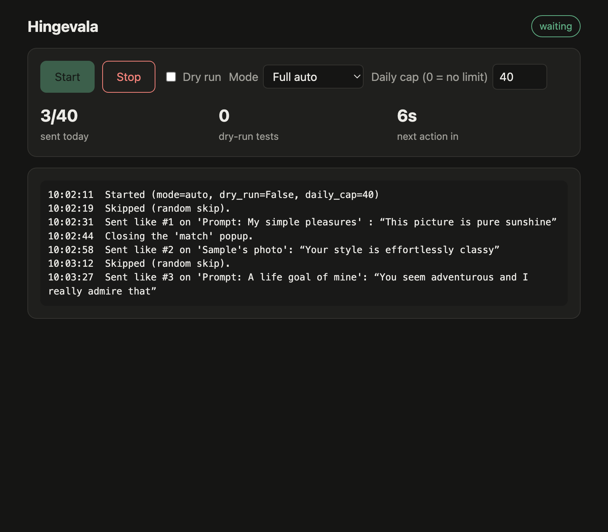
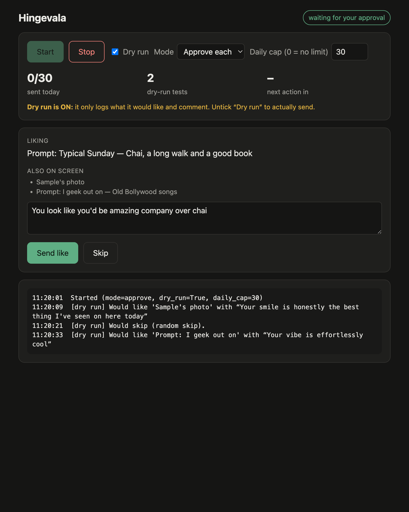

# Hingevala: setup and how it works

Hingevala sends Hinge likes, each with a short comment, from an **Android emulator** on your computer. You control it from a local web page with Start and Stop buttons.

> ⚠️ Automating Hinge breaks its Terms of Service and can get the account banned. Keep the limits low (`daily_cap`, `delay_seconds`).

---

## 1. What's in this folder

```
hingevala/
├── app.py              # Web server for the control page (FastAPI on http://127.0.0.1:8000)
├── config.json         # Limits and mode (daily cap, delays, active hours, dry run...)
├── selectors.json      # How the bot recognises Hinge's buttons and screens
├── comments.txt        # The comments it picks from, one per line
├── requirements.txt    # Python packages
├── hinge/
│   ├── bot.py          # The main loop: read screen → decide → act → wait
│   ├── ui.py           # Hinge actions: detect screen, like, comment, send, skip, restart app
│   ├── device.py       # Wrapper around uiautomator2 (human-like taps and swipes)
│   └── comments.py     # Picks a random comment without repeating recent ones
├── static/index.html   # The control page
├── tools/
│   ├── doctor.py       # Read-only check: which selectors match on screen right now
│   └── map_screen.py   # Read-only: saves the current screen layout to captures/
├── docs/screenshots/   # Screenshots used in this guide
├── data/               # Created at runtime: bot.log, state.json (likes sent today), unknown-screen dumps
└── captures/           # Created by map_screen.py
```

`data/`, `captures/` and `.venv/` are **not** in the git repo (see `.gitignore`). The bot creates them on the new machine. They hold logs and screen dumps that include other people's profile text.

---

## 2. How it works

### The big picture



Hinge blocks screenshots (they come out black), so the bot doesn't look at images. It reads the **UI layout as XML** (the accessibility tree) through `uiautomator2`, then finds buttons by their description, such as `Like photo`, `Skip <name>` or `Send like with message`. Those rules live in `selectors.json`.

### The loop (`hinge/bot.py`)



Safety details built in:
- **Human-like input**: taps land at a random point inside the button, swipes vary in position and speed, and the wait between actions is random.
- **Never sends an empty comment**: after typing, it checks that the button changed to *"Send like with message"* before tapping Send.
- **Never sends twice**: it taps Send again only while the like sheet is still open.
- **Self-healing**: if something goes wrong, it force-stops Hinge and opens it fresh (your login is untouched). After `max_restarts_in_a_row` restarts in a row, it stops.
- **Daily counter** is saved in `data/state.json` and resets each day.

### The control page

**Stopped.** Pick the mode, toggle dry run, set the daily cap, then press Start.



**Full auto, running.** Shows the likes sent today, a countdown to the next action, and a live log.



**Approve each.** Before each like, the page shows what's being liked (as text, because Hinge blocks screenshots), what else is on screen, and the drafted comment. You can edit the comment, then press **Send like** or **Skip**.



> The screenshots above use sample data. Profile names and log lines are made up.

### Modes

| Setting | What it does |
|---|---|
| `mode: "approve"` | Waits for you to press Send or Skip for every profile (times out after `approval_timeout_seconds`, then stops) |
| `mode: "auto"` | Sends without asking, within the limits |
| `dry_run: true` | Picks a target and a comment and logs them, but never opens the comment box or taps Send or Skip. **Use this first on a new machine.** |

### `config.json` reference

| Key | Meaning | Example |
|---|---|---|
| `device_serial` | ADB serial of the emulator. Leave `""` if only one is running | `"emulator-5554"` |
| `mode` | `approve` or `auto` | `"approve"` |
| `dry_run` | `true` = log only | `true` |
| `daily_cap` | Max likes per day, `0` = no limit | `30` |
| `delay_seconds` | Random wait between actions `[min, max]` | `[30, 120]` |
| `dry_run_delay_seconds` | Same, during dry runs | `[5, 10]` |
| `skip_probability` | Share of profiles skipped at random | `0.25` |
| `active_hours` | Hours it may run, `[start, end)`, 24h clock | `[8, 24]` |
| `max_scrolls` | Max random scrolls down a profile before picking a heart | `3` |
| `comment_no_repeat` | Don't reuse any of the last N comments | `40` |
| `approval_timeout_seconds` | How long approve mode waits for you | `600` |
| `max_restarts_in_a_row` | How many times Hinge may be reopened in a row before the bot stops | `3` |

Mode, dry run and daily cap can also be changed on the control page, which saves them back to `config.json`.

---

## 3. Running it on another machine

These steps are for macOS. Linux and Windows work the same way with their own paths.

### Step 1: Install the prerequisites

1. **Python 3.9 or newer**
   ```bash
   python3 --version
   ```
2. **Git**
3. **Android Studio** (it includes the emulator and `adb`): https://developer.android.com/studio
   After installing, open Android Studio → *More Actions* → *SDK Manager* and make sure these are installed:
   - *Android SDK Platform-Tools*
   - *Android Emulator*
   - A system image with **Google Play**, for example *Android 14 (API 34) Google Play, arm64-v8a* on Apple Silicon or *x86_64* on Intel
4. Add `adb` and `emulator` to your PATH (add these lines to `~/.zshrc`):
   ```bash
   export ANDROID_HOME="$HOME/Library/Android/sdk"
   export PATH="$ANDROID_HOME/platform-tools:$ANDROID_HOME/emulator:$PATH"
   ```

### Step 2: Create the emulator and install Hinge

1. Android Studio → *Device Manager* → *Create Virtual Device* → **Pixel 7** → pick the **Google Play** image → Finish. (The selectors were checked on a Pixel 7 running Android 14.)
2. Start it from Device Manager, or from the terminal:
   ```bash
   emulator -list-avds
   ```
   ```bash
   emulator -avd Pixel_7
   ```
3. On the emulator, open the **Play Store**, sign in, install **Hinge**, and log in to your Hinge account.
4. Check that `adb` sees the emulator:
   ```bash
   adb devices
   ```
   You should see a line like `emulator-5554   device`.

### Step 3: Get the code

```bash
git clone https://github.com/<owner>/hingevala.git
```
```bash
cd hingevala
```

### Step 4: Create the virtual environment and install the packages

```bash
python3 -m venv .venv
```
```bash
.venv/bin/pip install -r requirements.txt
```

On the first connection, `uiautomator2` installs a small helper app on the emulator automatically.

### Step 5: Check everything is wired up

Open Hinge on the emulator and go to the **Discover** tab, then run:

```bash
.venv/bin/python tools/doctor.py
```

Expected output, roughly:

```
Foreground app:      co.hinge.app
Detected screen:     ('discover', '')
Like buttons visible: 3
Skip button found:   True
Comment box found:   False
Send button found:   False
```

If `Detected screen` shows `discover` and the skip button is found, you're ready.

### Step 6: Start the control page

```bash
.venv/bin/python app.py
```

Open **http://127.0.0.1:8000** in your browser.

**First run:** tick **Dry run**, set mode to **Approve each**, press **Start**, and watch the log. When the picks look right, untick Dry run. Switch to **Full auto** only once you trust it.

Stop it with the **Stop** button. Press `Ctrl+C` in the terminal to shut down the server.

---

## 4. Customising

- **Comments**: edit `comments.txt`, one per line. Lines starting with `#` are ignored. A comment may land on a photo or a prompt, so keep them generic.
- **Limits**: edit `config.json` while the bot is stopped (it's re-read on Start).

### When Hinge updates and the bot stops finding buttons

Both tools are read-only and never tap anything.

1. Open the screen in question in Hinge (for example Discover, or a like sheet).
2. Save its layout:
   ```bash
   .venv/bin/python tools/map_screen.py discover
   ```
   This writes `captures/discover.xml` and a readable `captures/discover.txt`.
3. Find the button in the `.txt` file (look at `desc=` and `text=`) and update the matching entry in `selectors.json`.
4. Run `tools/doctor.py` again to confirm.

Unknown screens the bot hits while running are saved as `data/unknown-<time>.xml` for the same purpose.

---

## 5. Troubleshooting

| Problem | Fix |
|---|---|
| `adb devices` lists nothing | Start the emulator first. Then `adb kill-server && adb start-server` |
| `device offline` in the log | The emulator went to sleep or restarted. Restart it, open Hinge, press Start again |
| Several emulators running | Set `device_serial` in `config.json` (for example `"emulator-5554"`) |
| Log says *"Outside active hours"* | Change `active_hours` in `config.json`, for example `[0, 24]` |
| Log says *"Daily cap reached."* | Raise `daily_cap` or wait until tomorrow |
| Stops on *"upsell or paywall"* / *"verification"* | Handle that screen by hand in Hinge, then press Start |
| `urllib3 ... LibreSSL` warning | Harmless on macOS system Python. It's already silenced |
| Port 8000 already in use | Stop the other process, or change the port at the bottom of `app.py` |
| Logs | `data/bot.log` (includes full error tracebacks) |
